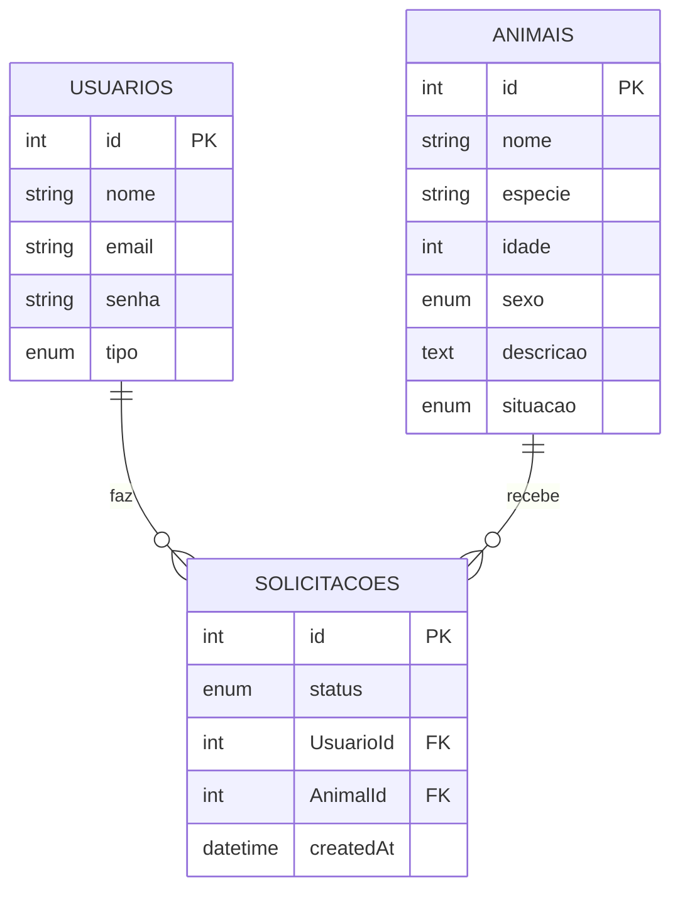
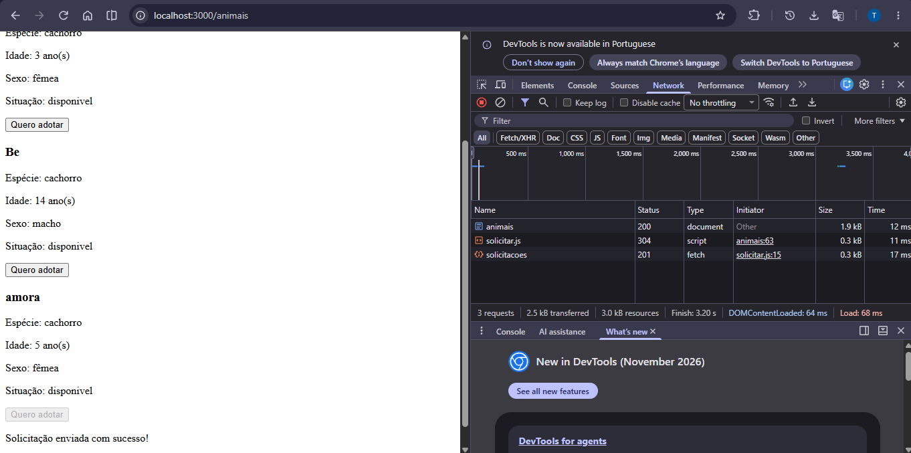
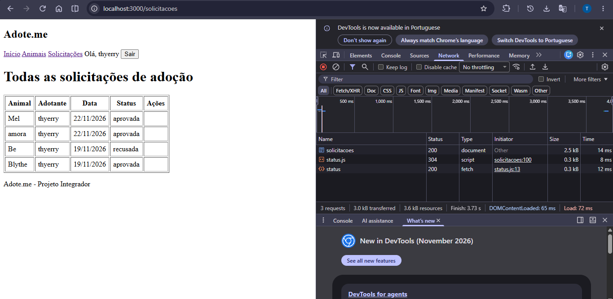
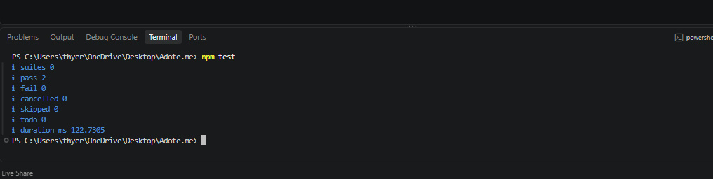

# Adote.me

Sistema web para facilitar a adoção de animais. Projeto Integrador da disciplina de Programação Web.

**Autor:** [Thyerry Anthony Santos Dutra]

## Acesso

- **Site publicado:** https://adote-me.onrender.com
- **Repositório:** https://github.com/thyerrya3-afk/Adote.me

> O site usa o plano gratuito da hospedagem. Se ficar um tempo sem acessos, o primeiro carregamento pode demorar alguns segundos.

### Usuários de teste

| Perfil | E-mail | Senha |
|---|---|---|
| Administrador | [admthyerry@gmail.com] | enviada ao professor por mensagem |
| Adotante | [adomaria@gmail.com] | enviada ao professor por mensagem |

## Sobre o projeto

O Adote.me permite que pessoas vejam os animais disponíveis para adoção e demonstrem interesse em adotar. Uma área administrativa permite gerenciar os animais e acompanhar as solicitações.

## Funcionalidades

**Adotante**

- Criar uma conta, entrar e sair.
- Ver os animais cadastrados.
- Enviar solicitação de adoção (sem recarregar a página).
- Acompanhar as próprias solicitações.
- Cancelar uma solicitação que ainda está pendente.

**Administrador**

- Entrar e sair.
- Cadastrar, listar, editar e excluir animais.
- Ver todas as solicitações de adoção.
- Aprovar ou recusar solicitações (sem recarregar a página). Ao aprovar, o animal passa a ficar como "adotado".

## Tecnologias

| Tecnologia | Uso |
|---|---|
| Node.js | Ambiente de execução |
| Express | Servidor e rotas |
| EJS | Páginas dinâmicas, com layout (cabeçalho e rodapé em `views/partials`) |
| Sequelize | ORM, comunicação com o banco |
| MySQL | Banco de dados (no site publicado, TiDB Cloud, compatível com MySQL) |
| express-session | Sessões |
| bcryptjs | Hash das senhas |
| express-rate-limit | Limite de tentativas de login |
| dotenv | Variáveis de ambiente |
| Fetch API | Funções AJAX |

## Estrutura de pastas (MVC)

```
Adote.me/
├── app.js                 # arquivo principal do servidor
├── config/
│   └── database.js        # conexão com o banco (Sequelize)
├── models/                # Model: Usuario, Animal, Solicitacao e relacionamentos
├── views/                 # View: páginas EJS
│   ├── partials/          # layout: header.ejs e footer.ejs
│   ├── animais/
│   ├── auth/
│   └── solicitacoes/
├── controllers/           # Controller: lógica de cada funcionalidade
├── routes/                # rotas (URLs)
├── middlewares/           # proteção de rotas e limite de login
├── public/                # arquivos estáticos
│   ├── css/
│   └── js/                # JavaScript do navegador (AJAX)
├── tests/                 # testes automatizados
└── docs/                  # prints usados neste README
```

## Banco de dados

Três entidades, com dois relacionamentos 1:N feitos com o ORM Sequelize (`models/index.js`):

- Um **usuário** pode fazer várias **solicitações**.
- Um **animal** pode receber várias **solicitações**.



A data da solicitação é a coluna `createdAt`, criada automaticamente pelo Sequelize.

## Requisitos do projeto

| Requisito | Como foi atendido |
|---|---|
| Arquitetura MVC com Express | Pastas `models`, `views` e `controllers`, mais `routes` |
| 3 entidades | Usuario, Animal, Solicitacao |
| Relacionamento 1:N com ORM | `hasMany` e `belongsTo` em `models/index.js` |
| CRUD completo de 2 entidades | Animais (criar, listar, editar, excluir) e Solicitações (criar, listar, atualizar status, cancelar) |
| Páginas EJS com layout | `views/partials/header.ejs` e `footer.ejs` incluídos em todas as páginas |
| 2 funções AJAX com Fetch | Veja a próxima seção |
| Cadastro, login e logout | `controllers/authController.js` |
| Sessões e área restrita | `express-session` e middlewares em `middlewares/auth.js` |
| Checklist de segurança | Veja a seção "Segurança" |
| Projeto publicado | https://adote-me.onrender.com |
| Repositório no GitHub | https://github.com/thyerrya3-afk/Adote.me |

## Funções AJAX (Fetch API)

**1. Solicitar adoção** (`public/js/solicitar.js`)
O adotante clica em "Quero adotar" e o navegador envia um `POST /solicitacoes` com `fetch`. A mensagem de resposta aparece na própria página, sem recarregar.



**2. Aprovar ou recusar solicitação** (`public/js/status.js`)
O administrador clica em "Aprovar" ou "Recusar" e o navegador envia um `PATCH /solicitacoes/:id/status` com `fetch`. O status muda na tabela, sem recarregar.



## Rotas

| Método | Rota | Quem acessa |
|---|---|---|
| GET | `/` | Todos |
| GET | `/animais` | Todos |
| GET | `/animais/novo` | Administrador |
| POST | `/animais` | Administrador |
| GET | `/animais/:id/editar` | Administrador |
| POST | `/animais/:id/editar` | Administrador |
| POST | `/animais/:id/excluir` | Administrador |
| GET, POST | `/cadastro` | Todos |
| GET, POST | `/login` | Todos (POST com limite de tentativas) |
| POST | `/logout` | Usuário logado |
| GET | `/solicitacoes` | Usuário logado (adotante vê as suas, administrador vê todas) |
| POST | `/solicitacoes` | Adotante logado |
| PATCH | `/solicitacoes/:id/status` | Administrador |
| POST | `/solicitacoes/:id/cancelar` | Dono da solicitação |

## Segurança

| Item | Como foi feito |
|---|---|
| Senhas com hash | `bcryptjs` no cadastro, e `bcrypt.compare` no login. O banco nunca guarda a senha original |
| Segredos fora do repositório | Arquivo `.env` no `.gitignore`. Na publicação, as variáveis ficam no painel da hospedagem |
| Dados escapados nas páginas | Uso de `<%= %>` nas views, que escapa HTML |
| Rotas protegidas | Middlewares `estaLogado` e `ehAdmin` rodam antes dos controllers |
| Dono do recurso | O id do usuário vem da sessão, e não do navegador. O adotante só vê e cancela as próprias solicitações |
| Limite de tentativas de login | `express-rate-limit`: 10 tentativas a cada 15 minutos |
| Cookie de sessão | `httpOnly` e expiração de 1 hora |
| Cadastro sem privilégio | O cadastro sempre cria um adotante. O administrador é definido direto no banco |
| Validação de entrada | O status recebido no AJAX só aceita `aprovada` ou `recusada` |
| Mensagem de login genérica | E-mail inexistente e senha errada mostram a mesma mensagem |
| Ações que alteram dados | Feitas com POST ou PATCH, nunca com GET |
| Proteção contra SQL injection | Consultas feitas pelo Sequelize, sem montar SQL na mão |

## Como rodar localmente

**Pré-requisitos:** Node.js 18 ou superior, MySQL e Git.

1. Clone o repositório e entre na pasta:

```bash
git clone https://github.com/thyerrya3-afk/Adote.me.git
cd Adote.me
```

2. Instale as dependências:

```bash
npm install
```

3. No MySQL, crie o banco:

```sql
CREATE DATABASE adote_me;
```

4. Copie o arquivo `.env.example` para `.env` e preencha os valores (veja a próxima seção).

5. Inicie o servidor:

```bash
npm start
```

6. Abra `http://localhost:3000`. As tabelas são criadas automaticamente na primeira execução.

7. Para criar um administrador: cadastre uma conta em `/cadastro` e, no MySQL, rode (trocando o `1` pelo id do usuário):

```sql
UPDATE usuarios SET tipo = 'administrador' WHERE id = 1;
```

## Variáveis de ambiente

Os valores não ficam no repositório. O arquivo `.env.example` mostra o formato.

| Variável | Para que serve |
|---|---|
| `DB_HOST` | Endereço do banco |
| `DB_PORT` | Porta do banco (3306 no MySQL local) |
| `DB_NAME` | Nome do banco |
| `DB_USER` | Usuário do banco |
| `DB_PASSWORD` | Senha do banco |
| `DB_SSL` | `true` para conexão segura (necessário na nuvem), `false` no MySQL local |
| `SESSION_SECRET` | Frase secreta que assina o cookie de sessão |

## Testes

Dois testes automatizados, com o executor de testes do próprio Node.js, conferem os middlewares de proteção:

1. Quem não está logado é redirecionado para `/login`.
2. Um adotante recebe erro 403 nas rotas de administrador.

```bash
npm test
```



## Publicação

- **Site:** Render (Web Service, plano gratuito), com `npm install` como build e `npm start` como comando de início.
- **Banco de dados:** TiDB Cloud (plano gratuito, compatível com MySQL), com conexão SSL.
- A cada `git push` na branch `main`, o Render publica a nova versão.

## Limitações conhecidas

- As sessões ficam na memória do servidor. Se a hospedagem reiniciar, os usuários precisam entrar de novo.
- O primeiro acesso depois de um período parado pode ser lento, por causa do plano gratuito.
- Não há upload de fotos dos animais, para manter o projeto simples.

## Uso de inteligência artificial

Parte do código e das explicações deste projeto foi desenvolvida com o auxílio do Claude (Anthropic), em um passo a passo. Todo o código foi testado e revisado pelo autor, que é capaz de explicar o funcionamento de cada parte.
